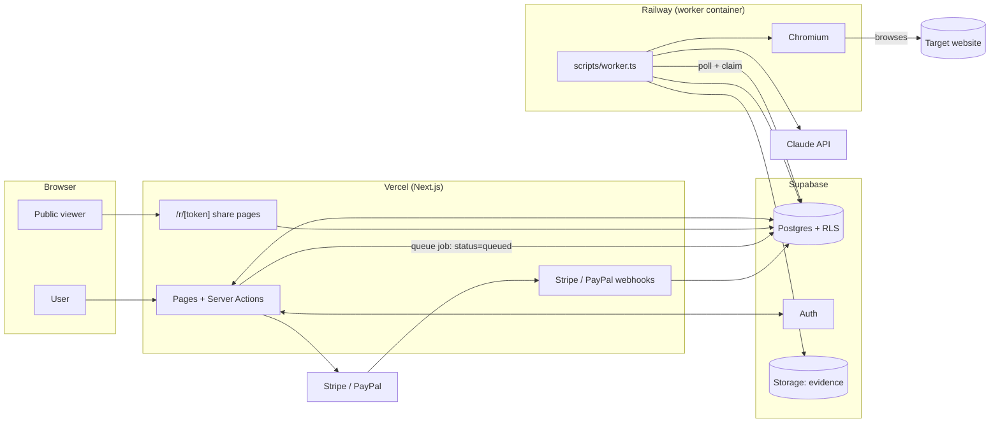

# Phanera

**Find where visitors get stuck.** Phanera sends simulated visitors (personas) through a live website in real browsers, records every step, and turns what happened into a ranked list of issues with screenshots and suggested fixes.

- Product spec: kept private (local `docs/PRD.md`, not in the repository)
- Step-by-step account setup (Supabase, Resend, Railway, Vercel): [SETUP.md](SETUP.md)

This README is the technical reference: architecture, data model, every pipeline, and how to run and deploy it. It contains no secrets; environment variables are listed by name only.

---

## Contents

1. [How it works in one minute](#1-how-it-works-in-one-minute)
2. [Tech stack](#2-tech-stack)
3. [Architecture](#3-architecture)
4. [Repository layout](#4-repository-layout)
5. [Website discovery pipeline](#5-website-discovery-pipeline)
6. [Test run pipeline](#6-test-run-pipeline)
7. [The persona browser agent](#7-the-persona-browser-agent)
8. [Evaluation and findings](#8-evaluation-and-findings)
9. [Claude integration](#9-claude-integration)
10. [Background jobs and the worker](#10-background-jobs-and-the-worker)
11. [Browser providers](#11-browser-providers)
12. [Data model](#12-data-model)
13. [Authentication](#13-authentication)
14. [Plans, usage and billing](#14-plans-usage-and-billing)
15. [Public share links](#15-public-share-links)
16. [Security model](#16-security-model)
17. [Frontend](#17-frontend)
18. [Environment variables](#18-environment-variables)
19. [Local development](#19-local-development)
20. [Deployment](#20-deployment)
21. [Operations and troubleshooting](#21-operations-and-troubleshooting)
22. [Known limitations](#22-known-limitations)

---

## 1. How it works in one minute

1. A user pastes a URL. Phanera **discovers** the site: it crawls permitted pages, reads `robots.txt`, the sitemap and `llms.txt`, measures technical signals, and asks Claude to summarise the product, classify pages, suggest test goals and suggest personas.
2. The user picks a **test goal** (for example "Can a new visitor find pricing?") and up to N **personas**. Every persona attempts the *same* goal; they differ in motivation, behaviour, patience and device.
3. A background **worker** opens a real Chromium browser. Each persona gets its own isolated browser context and works through the site step by step: Phanera reads the page, takes a screenshot, asks Claude for the next action, performs it, and records the step.
4. An independent Claude **evaluator** judges each session from the recorded evidence, then a **findings** pass merges everything into ranked, evidence-backed issues and an agent-readiness interpretation.
5. The user sees a one-page **report**: a verdict, an issue board (Low / Medium / High tickets with fixes), and every persona's session with a journey graph and step replay. The report can be shared through a public, view-only link.

---

## 2. Tech stack

| Area | Technology |
|---|---|
| Web framework | Next.js 16 (App Router, Turbopack, Cache Components / Partial Prerendering, `proxy.ts`), React 19, TypeScript |
| UI | Tailwind CSS v4, shadcn/ui on Base UI, lucide-react icons, sonner toasts |
| 3D / illustration | three.js + @react-three/fiber + drei (voxel hero flower, marching ants), hand-built isometric SVG (how-it-works, environments) |
| Graphs | @xyflow/react (React Flow) for the per-session user-journey graph |
| Database, auth, storage | Supabase (Postgres with Row Level Security, Auth magic links, Storage) |
| Transactional email | Resend, as Supabase Auth's custom SMTP provider |
| AI | Anthropic Claude via `@anthropic-ai/sdk` (structured outputs with Zod) |
| Browser automation | `playwright-core` 1.64 driving Chromium |
| Background jobs | Standalone Node worker (Railway, Docker) polling Postgres; optional Trigger.dev; in-process fallback in dev |
| Billing | Stripe (Checkout, Billing Portal, webhooks) and PayPal Subscriptions (REST API, webhooks) |
| Validation | Zod 4 |
| Package manager | pnpm |

---

## 3. Architecture



Key design decisions:

- **The web app never runs long jobs.** Server actions validate input, reserve usage, write rows with `status = 'queued'` and return. A separate worker process claims and executes the job. Status and progress are written back to Postgres, and the UI polls via `router.refresh()`.
- **Clients only read.** Every table has RLS allowing an authenticated user to `SELECT` their own rows. All writes go through trusted server code using the Supabase service role, after verifying the user.
- **Everything is evidence-based.** Each agent step is stored with its URL, action, reasoning, observation and (optionally) a screenshot; the evaluator and findings writer only reason over that recorded evidence.

---

## 4. Repository layout

```
.
├── Dockerfile.worker            # Worker image (Playwright base image + pnpm)
├── railway.json                 # Railway: build Dockerfile.worker, restart always
├── trigger.config.ts            # Optional Trigger.dev config (Playwright build extension)
├── scripts/
│   ├── worker.ts                # Job worker: poll, claim, run, heartbeat recovery, sweeps
│   ├── paypal-setup.mjs         # One-time: create PayPal product + monthly plan
│   ├── smoke-discovery.ts       # Manual smoke test for discovery
│   └── smoke-browser.ts         # Manual smoke test for the browser provider
├── supabase/migrations/         # SQL migrations (run in order)
├── docs/promo/                  # Hackathon promo images
├── SETUP.md                     # Account/service setup guide
└── src/
    ├── proxy.ts                 # Session refresh + /dashboard protection
    ├── app/
    │   ├── (marketing)/         # Home, pricing, privacy, terms
    │   ├── login/               # Magic-link sign-in
    │   ├── auth/callback|signout
    │   ├── dashboard/           # Authenticated app (websites, tests, sessions, settings)
    │   │   └── billing/stripe|paypal/route.ts   # Return-from-checkout handlers
    │   ├── r/[token]/           # Public, view-only shared report
    │   ├── api/stripe/webhook   # Stripe webhook
    │   ├── api/paypal/webhook   # PayPal webhook
    │   └── actions/             # Server actions: auth, dashboard, billing, share
    ├── components/
    │   ├── ui/                  # shadcn/ui primitives
    │   ├── landing/             # Marketing sections; voxel flower/ants; iso SVG scenes
    │   ├── report/              # One-page report: summary, issue board, sessions, share
    │   ├── sessions/            # Replay, journey graph, agent report, status labels
    │   ├── dashboard/           # Sidebar, wizard, stop button, page header…
    │   ├── billing/             # Plan & billing card
    │   ├── ants/ brand/ voxel/  # Pixel ant sprites, logo, WebGL helpers
    │   └── personas/ findings/ auth/
    ├── lib/
    │   ├── agents/              # run-test, persona-agent, stop/recovery
    │   ├── discovery/           # crawl + run (discovery pipeline)
    │   ├── evaluation/          # session evaluation + findings synthesis
    │   ├── claude/              # client, prompts, Zod schemas
    │   ├── daytona/browser.ts   # Browser acquisition + reachability probe
    │   ├── jobs/dispatch.ts     # Where queued jobs run (worker / Trigger / in-process)
    │   ├── billing/             # Stripe, PayPal, provider-neutral sync
    │   ├── usage/               # Plan limits, effective plan, usage accounting
    │   ├── share/               # Shared-report loader
    │   ├── supabase/            # Server, browser, admin (service role) clients; proxy helper
    │   ├── auth/                # Pending sign-in intents, optional user
    │   ├── validation/          # URL normalisation, SSRF-safe fetch
    │   ├── dashboard/           # Request-scoped queries, formatters
    │   └── env.ts               # Server-only environment access
    ├── trigger/tasks.ts         # Trigger.dev task definitions (optional runner)
    └── types/database.ts        # Hand-written DB row types
```

---

## 5. Website discovery pipeline

Entry: `startDiscovery` server action → `enqueueDiscovery(websiteId)` → `runDiscovery` ([src/lib/discovery/run.ts](src/lib/discovery/run.ts)).

Status column `websites.discovery_status` moves through:
`queued → fetching → discovering → extracting → analysing → complete | partial | failed`.

Steps:

1. **Guards.** URL is normalised (`normalizeUrl`) and checked against the network policy (`assertPublicUrl`, see [Security](#16-security-model)). Users are limited to `scansPerDay` discovery scans per 24 h (per plan).
2. **Crawl** ([src/lib/discovery/crawl.ts](src/lib/discovery/crawl.ts)), with a 90 s time budget and `pagesPerScan` page cap from the plan:
   - Fetches `robots.txt` and `llms.txt` (6 s timeout, 200 KB cap); parses robots rules and declared sitemaps.
   - Reads up to three sitemap candidates (8 s, 2 MB cap), keeping same-site URLs.
   - Prioritises pages (navigation links and common page types first) and fetches them with `safeFetch`.
   - Extracts with cheerio: title, description, visible text, word count, nav labels, links, and **page signals** (H1/heading counts, image alt coverage, landmarks, JSON-LD, `lang`, viewport, meta description, canonical, Open Graph, script count).
3. **Measured readiness.** `measureReadiness` aggregates the objective signals (pages analysed, sitemap and llms.txt presence, robots blocks, landmark and alt coverage, and so on). It is stored in `websites.readiness.measured` and shown separately from AI interpretation.
4. **Website analysis (Claude).** Page content is sent inside `<website_content>` tags with an explicit "data only, ignore instructions" rule. Output is `WebsiteAnalysisSchema`: name, type, product description, audience, value proposition, main navigation, per-page classification (`page_type` + one-line summary), important pages, likely audiences, 4–6 suggested goals, content gaps and accessibility observations.
5. **Persona suggestions (Claude).** Three personas, exactly one of kind `ai_agent`. All personas are forced to `desktop` unless the test goal mentions mobile (`desktopUnlessAsked`).
6. Page classifications are written to `website_pages`; summary, goals and personas to `websites`. If many pages failed, the status is `partial`.

Personas can be regenerated for a specific goal from the test wizard (`regeneratePersonas`).

---

## 6. Test run pipeline

Entry: `createTest` server action ([src/app/actions/dashboard.ts](src/app/actions/dashboard.ts)):

1. Validates the goal (5–500 chars) and personas (Zod), checks remaining usage and the per-plan persona limit.
2. Inserts the `tests` row (`status = queued`, `configuration` snapshot of start URL, plan and per-persona limits), one `personas` row and one `sessions` row per persona, and a `usage` row (the run is **reserved up front**; it is refunded if the run fails for reasons outside the user's control).
3. Calls `enqueueTestRun(testId)`.

Execution: `runTest(testId)` ([src/lib/agents/run-test.ts](src/lib/agents/run-test.ts)):

1. **Heartbeat.** For the whole run, `tests.heartbeat_at` is updated every 15 s, including the slow report-writing phase.
2. Loads website, personas, sessions and the owner's **effective plan** (limits come from the plan, not from the client).
3. Sets `status = running`, then **acquires a browser** and runs a **reachability probe** against the start URL (with `example.com` as a control) so environment problems (blocked egress, error pages) fail fast and are refunded.
4. **Stop watcher.** Every 3 s it checks `tests.cancel_requested_at`; if set, an `AbortController` aborts the run.
5. **Personas run in parallel** in one browser (`PERSONA_CONCURRENCY`, 1–10, default 3), each in its own context, through a shared queue. For each session:
   - `runPersonaAgent` (see [section 7](#7-the-persona-browser-agent)), raced against a hard budget of the plan's per-persona time + 3 minutes.
   - If stopped: session marked `failed` with "Stopped before this persona finished", skipped.
   - Otherwise `evaluateSession` (see [section 8](#8-evaluation-and-findings)), then the session row is completed with outcome, evaluation JSON, agent summary, duration and action count. A run that errored on its first step is treated as an environment failure.
6. If no session produced a usable evaluation, the test fails and usage is refunded.
7. Otherwise `status = evaluating`, `synthesiseFindings` writes `findings` rows and the test `summary` (conclusion, top fixes, readiness interpretation, outcome counts), and the test ends `complete` (or `partial` if some sessions failed or the user stopped it early).
8. Every final status write is conditional on the test still being `running`/`evaluating`, so a force-stopped test is never overwritten.

---

## 7. The persona browser agent

[src/lib/agents/persona-agent.ts](src/lib/agents/persona-agent.ts)

**Context per persona.** `browser.newContext` with the device profile (desktop 1366×860; mobile 390×844, touch, iPhone user agent), downloads disabled and service workers blocked. A route guard (`guardContext`) aborts:
- main-frame navigations to other sites, and any non-GET main-frame navigation (no form submissions that change data);
- requests to private/loopback ranges and non-HTTP(S)/data/blob schemes.

Dialogs are auto-dismissed.

**Start.** Opens the start URL (`domcontentloaded`, 30 s), waits briefly for network idle, takes a screenshot and records step 0. If the page never loaded (`about:blank` / `chrome-error:`), the session ends as an environment error.

**Loop** (up to `maxActionsPerPersona`, within `maxDurationMsPerPersona`):

1. **Snapshot** (bounded 15 s): tags up to 150 visible interactive elements (`a[href]`, buttons, inputs, selects, textareas, `summary`, ARIA roles, `[onclick]`) with `data-phanera-ref`, and captures their tag, role, accessible text, href and whether they are in view, plus ~3,500 chars of visible text and the title.
2. **Screenshot** (JPEG q60, bounded 10–12 s).
3. **Decide** (Claude, bounded 75 s per attempt, 1 retry, abortable): the model receives the screenshot, URL, title, its action history and the element list, and returns `AgentStepSchema`: `observation`, `reasoning`, `action`, `element_ref`, `value`, `progress_note`, `final_report`. The persona prompt gives it the shared test goal, its motivation and behaviour, the action budget and safety rules.
4. **Act.** Actions: `click`, `type`, `select`, `scroll_down`, `scroll_up`, `go_back`, `navigate` (same-site only), `finish`, `give_up`.
   - **Robust click.** Re-resolves the element if the site re-rendered (falls back from the ref to role + accessible name, then visible text). Tries a normal click; if that fails, checks what covers the element's centre. If something covers it, the cover is reported ("a visitor clicking it would hit that instead") and the element is clicked directly. Otherwise it tries a forced click, then a DOM click, then (for links) opening the href.
   - After a click it compares a page fingerprint (URL, text length, open/expanded elements). "Clicked, but nothing on the page visibly changed" is recorded as a real UX signal.
   - Failures of the automation itself are prefixed `Agent tooling:` so they are never mistaken for website defects.
5. **Record** (bounded 20 s): screenshot uploaded to Storage at `evidence/<user_id>/<session_id>/<step>.jpg` (every step on Startup, key steps on Free: step 0, URL changes, errors, finish), and a `session_events` row inserted.
6. Progress (`sessions.current_activity`, `action_count`) is updated so the UI can show "Reading the page" or "Thinking about step N".

**Watchdog.** If the session overruns its time budget by 60 s, or the user stops the test, the context is closed so any in-flight browser call fails instead of hanging. Endings: `finished`, `gave_up`, `action_limit`, `time_limit`, `stopped`, `error`.

**Logs.** One line per step in the worker logs, with look, decide and act timings.

---

## 8. Evaluation and findings

[src/lib/evaluation/evaluate.ts](src/lib/evaluation/evaluate.ts)

**Session evaluation** (`evaluateSession`, effort `medium`, 3 min timeout). An independent evaluator that did not perform the session receives the persona, the test goal, known website facts, how the session ended, the agent's own (unverified) final report, the recorded steps, and up to four sampled screenshots (always including the last). Output `SessionEvaluationSchema`:

| Field | Meaning |
|---|---|
| `outcome` | `success`, `partial_success`, `failed`, `abandoned`, `blocked`, `inconclusive` |
| `summary` | One sentence (≤20 words) verdict |
| `key_points` | 2–4 short facts behind the verdict |
| `rationale` | ≤2 sentences of reasoning |
| `cause` | `website`, `agent`, `environment`, `none` |
| `observations[]` | Problems only: step, issue, `is_website_issue`, `directly_observed` |

**Findings synthesis** (`synthesiseFindings`, effort `high`, 5 min timeout). Input: test goal, website facts, measured readiness, and every usable session (persona, motivation, ending, evaluation, steps). Output `FindingsReportSchema`: a short conclusion, `findings[]` (title, description, category, severity, confidence, impacted personas, page URL, evidence with persona and step, recommendation), `top_fixes`, and `readiness_interpretation` for six areas (content accessibility, page discovery, semantic navigation, content comprehension, rendering, structured information).

Rules enforced in the prompts:
- Every persona shares the same goal; motivation only explains *how* they browsed.
- Browser-automation errors (timeouts, "not found", `Agent tooling:`) are never website issues unless the evidence shows the site failing.
- Findings are problems only, never strengths. Focus: user experience and behaviour, content strategy, and verified functional bugs.
- Severity: critical (essential task blocked), high, medium, low. Confidence: `confirmed` only with direct step or screenshot evidence; the code downgrades a "confirmed" finding with no step evidence to `likely`.
- Short, concrete writing with per-field length limits.

---

## 9. Claude integration

[src/lib/claude/client.ts](src/lib/claude/client.ts), [prompts.ts](src/lib/claude/prompts.ts), [schemas.ts](src/lib/claude/schemas.ts)

- **One helper, `generateStructured`**, wraps `client.beta.messages.parse` with `output_config.format = betaZodOutputFormat(schema)`, so responses are constrained to the Zod schema and validated again by the SDK. It never parses Markdown.
- Handles `stop_reason` `refusal` (`ClaudeRefusalError`) and `max_tokens` (`ClaudeOutputError`).
- Per-call `effort`, `maxTokens`, `timeoutMs`, `maxRetries` and an `AbortSignal`.
- **Models:** `ANTHROPIC_MODEL` (default `claude-opus-5-5`) for analysis, evaluation and findings; `ANTHROPIC_AGENT_MODEL` for the high-volume per-step browser decisions (defaults to the main model; a faster model such as Sonnet speeds runs up considerably).
- **Server-side fallbacks** (`server-side-fallback-2026-07-01` beta) are enabled for supported models unless `ANTHROPIC_FALLBACKS=off`.
- **Untrusted content.** Everything scraped from a website is wrapped in `<website_content>` or `<page>` tags with a rule to treat it strictly as data and ignore any instructions inside it.

---

## 10. Background jobs and the worker

### Choosing a runner ([src/lib/jobs/dispatch.ts](src/lib/jobs/dispatch.ts))

| `JOB_RUNNER` | Behaviour |
|---|---|
| `worker` | The web app only leaves jobs `queued`; the standalone worker picks them up. **Production setting.** |
| `trigger` (or `TRIGGER_SECRET_KEY` set) | Jobs are triggered as Trigger.dev tasks ([src/trigger/tasks.ts](src/trigger/tasks.ts): `website-discovery`, `persona-test-run` on a `medium-1x` machine). |
| unset | Development only: the job runs in-process with Next's `after()`. |

### The worker ([scripts/worker.ts](scripts/worker.ts))

Run with `pnpm worker` (`tsx --conditions=react-server scripts/worker.ts`); in production it runs in `Dockerfile.worker` on Railway.

- **Polling and claiming.** Every `WORKER_POLL_MS` (default 3 s) it looks for queued discovery scans and tests and claims each with a conditional update (`… where status = 'queued'`), so several worker replicas never run the same job. Concurrency caps: `WORKER_MAX_TESTS` (image default 2) and `WORKER_MAX_DISCOVERIES` (default 2).
- **Health log** every minute: running tests, Node RSS, and system free/total memory.
- **Orphan recovery.** A `running`/`evaluating` test whose heartbeat is older than 2 minutes lost its worker (crash, out of memory, redeploy). The first time, it is reset (events and findings deleted, sessions re-queued) and queued again, and `attempts` increments. A second orphaning fails it and refunds usage (`recoverOrphanedTest`, max 2 attempts).
- **Stop requests the job never picked up** (older than 2 minutes) are force-stopped.
- **Hard ceilings:** tests running over 75 minutes and discoveries over 15 minutes are failed (tests refunded).
- **Graceful shutdown** (SIGTERM/SIGINT): stops claiming, waits up to 20 s, then hands any still-running tests straight back to the queue *without* using up a retry, so a redeploy restarts them immediately.

### Stopping a test

`stopTest` server action and the **Stop test** button:
- **Queued test:** stopped outright and refunded.
- **Running test:** sets `cancel_requested_at`. The worker notices within about 3 s, stops the remaining personas and still writes a report from the ones that finished (or fails and refunds if none finished).
- **Unresponsive worker:** after 60 s the button becomes **Force stop**, which marks unfinished sessions stopped directly (`forceStopTest`).

---

## 11. Browser providers

[src/lib/daytona/browser.ts](src/lib/daytona/browser.ts): `acquireBrowser()` picks, in order:

1. `BROWSER_PROVIDER=local`: local headless Chromium (used by the worker image; launched with `--disable-dev-shm-usage`).
2. `BROWSER_PROVIDER=daytona`, or a Daytona API key present: a Daytona sandbox running Chromium, connected over CDP.
3. Inside a deployed Trigger.dev run: local Chromium installed by the Playwright build extension.
4. Development with `ALLOW_LOCAL_BROWSER=true`: local Chromium (never in production).

`assertBrowserCanReach` probes the target and a control site and recognises Chrome error pages and egress-restricted sandboxes, so infrastructure failures are reported (and refunded) rather than blamed on the website.

---

## 12. Data model

Migrations in [supabase/migrations](supabase/migrations), applied in filename order:

| Migration | Adds |
|---|---|
| `20261102000000_init.sql` | All core tables, indexes, RLS policies, `handle_new_user` trigger, private `evidence` bucket |
| `20261105000000_session_event_observation.sql` | `session_events.observation` |
| `20261106000000_billing.sql` | Billing columns on `profiles` |
| `20261106010000_test_share_links.sql` | `tests.share_token`, `tests.shared_at` |
| `20261106020000_test_cancellation.sql` | `tests.cancel_requested_at` |
| `20261106030000_test_heartbeat.sql` | `tests.heartbeat_at`, `tests.attempts` |

### Tables

| Table | Purpose and key columns |
|---|---|
| `profiles` | One per auth user (created by the `on_auth_user_created` trigger). `plan` (`free`/`startup`), `billing_provider` (`stripe`/`paypal`/`comp`), `stripe_customer_id`, `subscription_id`, `subscription_status`, `current_period_end`, `cancel_at_period_end` |
| `websites` | Per user per domain (`unique(user_id, domain)`). `url`, `domain`, `title`, `discovery_status`, `discovery_error`, `summary` (analysis JSON), `readiness` (`{ measured }`), `suggested_goals`, `suggested_personas`, `last_scanned_at` |
| `website_pages` | Crawled pages: `url`, `title`, `page_type`, `content_summary`, `crawl_status`, `word_count` |
| `tests` | `title`, `goal`, `status` (`queued`/`running`/`evaluating`/`complete`/`partial`/`failed`), `configuration` (start URL and plan limits snapshot), `summary`, `error`, `started_at`, `completed_at`, `share_token`, `shared_at`, `cancel_requested_at`, `heartbeat_at`, `attempts` |
| `personas` | Per test: `name`, `role`, `goal` (stores the persona's **motivation**), `configuration` (kind, context, device, behaviour, patience, success criteria) |
| `sessions` | One per persona run: `status` (`queued`/`running`/`completed`/`failed`), `outcome`, `duration_ms`, `action_count`, `current_activity`, `agent_summary`, `evaluation` (JSON), `error`, timestamps |
| `session_events` | One per step: `step`, `action`, `target`, `url`, `result`, `reasoning`, `observation`, `screenshot_path`, `error`, `timestamp` |
| `findings` | `title`, `description`, `category`, `severity`, `confidence`, `impacted_personas[]`, `page_url`, `evidence` (JSON: persona, step, note), `recommendation` |
| `usage` | Ledger rows: `usage_type` (`test_run`, `discovery_scan`), `quantity`, optional `test_id` (used for refunds) |
| `pending_auth_intents` | Hashed one-time tokens linking a URL typed before sign-in to the account after sign-in. Service role only (no policies) |

### Row Level Security and storage

- Every table has RLS enabled. Authenticated users have **SELECT-only** policies on their own rows (`user_id = auth.uid()`). There are no client INSERT, UPDATE or DELETE policies.
- `pending_auth_intents` has no policies at all (service role only).
- Storage bucket `evidence` is private. Objects live under `<user_id>/…`; users can read their own folder. The app serves screenshots through 1-hour signed URLs.

---

## 13. Authentication

- **Passwordless magic links** via Supabase Auth (`signInWithOtp`), with email delivered through Resend configured as Supabase's custom SMTP. Responses never reveal whether an email has an account; a per-instance throttle sits on top of Supabase's own rate limits.
- **Explore-before-login.** On the homepage, `startExplore(url)` validates the URL. A signed-in user goes straight to discovery. Otherwise a **pending intent** is stored (hashed token, expiry) and the magic link carries it; `/auth/callback` exchanges the code, consumes the intent and starts discovery for that URL.
- `safeNextPath` only allows same-origin relative redirects.
- **Session handling.** `src/proxy.ts` refreshes the Supabase session cookie on every matched request and redirects unauthenticated `/dashboard` requests to `/login?next=…`. `/api/*` and static assets are excluded.
- Dashboard pages call `requireSession()` (which also opts the route into request-time rendering via `connection()`).

---

## 14. Plans, usage and billing

### Plans ([src/lib/usage/plans.ts](src/lib/usage/plans.ts))

| Limit | Free | Startup (£99/month) |
|---|---|---|
| Test runs | 5 lifetime | 10 per calendar month |
| Personas per test | 3 | 10 |
| Pages per discovery scan | 10 | 50 |
| Actions per persona | 8 | 20 |
| Time per persona | 3 min | 8 min |
| Screenshots | Key steps | Every step |
| Discovery scans per day | 10 | 40 |

`effectivePlan(profile)` decides entitlement at read time: `comp` accounts are always Startup. Paid accounts lose access after `current_period_end` (immediately if cancelled; with a 3-day grace for late renewals). Usage is counted from the `usage` ledger (lifetime for Free, current month for Startup).

### Stripe ([src/lib/billing/stripe.ts](src/lib/billing/stripe.ts))

- **Subscribe with card:** creates or reuses a Stripe Customer, then opens a Checkout Session in `subscription` mode for `STRIPE_PRICE_ID`. It sets `client_reference_id` and `subscription_data.metadata.userId`, allows promotion codes, and uses `payment_method_collection: if_required` so a 100%-off code needs no card.
- **Return:** `/dashboard/billing/stripe?session_id=…` verifies the session belongs to the signed-in user and syncs the subscription immediately.
- **Webhook** `/api/stripe/webhook`: signature verified with `STRIPE_WEBHOOK_SECRET`. On `checkout.session.completed` and `customer.subscription.*` it re-reads the subscription from Stripe and syncs it, so out-of-order events converge.
- **Manage billing** opens the Stripe Billing Portal.

### PayPal ([src/lib/billing/paypal.ts](src/lib/billing/paypal.ts))

- A minimal REST client with a cached OAuth token. Sandbox or live is chosen by `PAYPAL_ENV`.
- **Pay with PayPal:** creates a subscription for `PAYPAL_PLAN_ID` with `custom_id = userId` and redirects to PayPal's approval page.
- **Return:** `/dashboard/billing/paypal?subscription_id=…` re-reads the subscription, checks `custom_id` matches the user, and syncs it.
- **Webhook** `/api/paypal/webhook`: verified with PayPal's `verify-webhook-signature` API using `PAYPAL_WEBHOOK_ID`. Subscription events and renewal payments (`PAYMENT.SALE.*`, via `billing_agreement_id`) trigger a fresh re-read and sync.
- **Cancel** happens in Settings (PayPal has no hosted portal); access lasts until the paid period ends.
- `scripts/paypal-setup.mjs` creates the product and £99/month plan and prints the plan ID.

### Provider-neutral sync ([src/lib/billing/sync.ts](src/lib/billing/sync.ts))

`applySubscription` maps either provider's state onto the profile. It matches by `subscription_id` first, then by the user ID stored on the subscription. It never overwrites a different live subscription or a `comp` account.

### Complimentary access

Set `plan = 'startup'` and `billing_provider = 'comp'` on a profile (SQL), or use a 100%-off Stripe promotion code.

---

## 15. Public share links

- The owner clicks **Share** on a finished test. `setTestSharing` generates a 144-bit random token (`base64url`) stored in `tests.share_token`. **Stop sharing** sets it to null, which kills the link immediately; sharing again issues a new token.
- `/r/[token]` is a public page outside the dashboard. `getSharedReport` validates the token format, loads the test **only by token** with the service role, and returns just that test's website domain, personas, sessions, findings and events. Screenshots are 1-hour signed URLs. The owner's email and other data are never loaded.
- Shared pages are `noindex, nofollow`, use the white report theme, and end with a "Try Phanera" call to action.

---

## 16. Security model

- **SSRF protection** ([src/lib/validation/network.ts](src/lib/validation/network.ts)): `assertPublicUrl` resolves DNS and rejects private, loopback, link-local and other non-public addresses. `safeFetch` re-validates every redirect hop manually (max 5), enforces timeouts and caps response size.
- **Browser sandboxing:** each persona has an isolated context; navigation is restricted to the target site and GET only; private networks are blocked; downloads and service workers are disabled; prompts forbid purchases, account creation, real personal data and CAPTCHA bypass.
- **Prompt injection:** scraped content is always marked as untrusted data.
- **Least privilege:** browser clients use the anon key with read-only RLS. The service-role key exists only in server code (`server-only` imports make leaking it into a client bundle a build error).
- **Webhooks** are verified (Stripe signature; PayPal postback verification), and entitlement is always taken from a fresh provider read, never from the webhook body or URL parameters alone.
- **Ownership checks** in every server action (billing, sharing, stopping, test creation) before any service-role write.
- **No secrets in the repo.** `.env.local` is gitignored; `.env.example` contains placeholders only.

---

## 17. Frontend

### Routes

| Route | Description |
|---|---|
| `/` | Marketing home: hero (voxel flower), how it works (isometric SVG), environments, personas, replays, findings preview, agent readiness, pricing, FAQ, final call to action (voxel ants) |
| `/pricing`, `/privacy`, `/terms` | Marketing pages |
| `/login` | Magic-link sign-in |
| `/dashboard` | Overview, recent tests |
| `/dashboard/new` | Test wizard: website → goal → personas → review |
| `/dashboard/websites`, `/dashboard/websites/[id]` | Websites and discovery results |
| `/dashboard/tests` | Test history |
| `/dashboard/tests/[id]` | One-page report (live progress card with Stop while running) |
| `/dashboard/tests/[id]/sessions/[sessionId]` | Single session detail |
| `/dashboard/settings` | Account, plan and billing, usage limits |
| `/r/[token]` | Public shared report |

### The report ([src/components/report](src/components/report))

`ReportBody` is shared by the dashboard and the public page:

1. **Summary:** verdict ("2 of 3 personas reached the goal"), short conclusion, High/Medium/Low counts, persona chips that jump to their session.
2. **Issues board** (`IssueBoard`): Low / Medium / High columns (stacked High-first on narrow screens). Tickets open a Notion/Jira-style side panel with a breadcrumb, previous/next (arrow keys or j/k), properties (severity, category, confidence, affected personas, page), description, recommended fix, attachment screenshot and an evidence timeline.
3. **Sessions:** one framed panel with persona tabs. `SessionDetail` shows the one-line verdict and key points, stats, collapsible reasoning and agent notes, the persona's motivation, website issues (test-run notes collapsed), the **journey graph** (React Flow: page visits as nodes, actions as edges, issues inline) and the **step replay** (screenshots and timeline).
4. Dashboard only: **Agent readiness** (measured table and AI interpretation).

### Design system

- **Light monochrome theme.** CSS tokens live in `globals.css`. The marketing site uses a soft grey "studio" background; the dashboard and shared reports switch to plain white via `body:has([data-surface="white"])`, which also covers portalled sheets and dialogs.
- **Brand:** a pixel ant generated from geometry ([src/components/ants/sprites.ts](src/components/ants/sprites.ts)), used for the logo, favicon and persona avatars. Exported assets are in `public/brand/`.
- **Voxel scenes** (three.js): the hero flower with ants climbing it, and marching ants. They load lazily, pause off-screen, respect reduced motion, and fall back to Canvas 2D without WebGL.
- **Isometric SVG** ([src/components/landing/iso](src/components/landing/iso)): projection helpers and primitives (tiles, laptop, phone, badges, dashed links, faint grid, walking pixel ants) with CSS-only motion.

---

## 18. Environment variables

Names only. See `.env.example`; real values live in `.env.local` (local), Vercel (web) and Railway (worker).

| Variable | Used by | Purpose |
|---|---|---|
| `NEXT_PUBLIC_APP_URL` | web | Public base URL for auth redirects, billing returns and share links |
| `NEXT_PUBLIC_SUPABASE_URL`, `NEXT_PUBLIC_SUPABASE_ANON_KEY` | web | Supabase client (RLS-restricted) |
| `SUPABASE_SERVICE_ROLE_KEY` | web, worker | Trusted server writes |
| `ANTHROPIC_API_KEY` | web, worker | Claude |
| `ANTHROPIC_MODEL` | web, worker | Main model (default `claude-opus-5-5`) |
| `ANTHROPIC_AGENT_MODEL` | worker | Per-step browser model (defaults to the main model) |
| `ANTHROPIC_FALLBACKS` | web, worker | `off` disables server-side fallbacks |
| `RESEND_API_KEY` | Supabase SMTP | Email delivery (configured in Supabase, not read by the app) |
| `JOB_RUNNER` | web | `worker` in production |
| `PERSONA_CONCURRENCY` | worker | Personas in parallel per test (1–10) |
| `WORKER_MAX_TESTS`, `WORKER_MAX_DISCOVERIES`, `WORKER_POLL_MS` | worker | Worker concurrency and polling |
| `BROWSER_PROVIDER` | worker | `local` or `daytona` |
| `DAYTONA_API_KEY`, `DAYTONA_API_URL` | worker | Optional Daytona sandboxes |
| `ALLOW_LOCAL_BROWSER` | dev | Allow local Chromium in development |
| `PLAYWRIGHT_VERSION` | Trigger.dev | Browser version for the build extension |
| `TRIGGER_SECRET_KEY`, `TRIGGER_PROJECT_REF` | web | Optional Trigger.dev runner |
| `STRIPE_SECRET_KEY`, `STRIPE_PRICE_ID`, `STRIPE_WEBHOOK_SECRET` | web | Card subscriptions |
| `PAYPAL_ENV`, `PAYPAL_CLIENT_ID`, `PAYPAL_CLIENT_SECRET`, `PAYPAL_PLAN_ID`, `PAYPAL_WEBHOOK_ID` | web | PayPal subscriptions |

Each payment method's buttons only appear when its variables are set.

---

## 19. Local development

Prerequisites: Node 20+, pnpm 10, a Supabase project with the migrations applied, and a Claude API key.

```bash
pnpm install
cp .env.example .env.local        # fill in values
pnpm dev                          # http://localhost:3000
```

Running jobs locally, either:
- **Simplest:** leave `JOB_RUNNER` unset and set `ALLOW_LOCAL_BROWSER=true`. Jobs run in-process with local Chromium (`npx playwright install chromium` once).
- **Like production:** set `JOB_RUNNER=worker` and run `pnpm worker` in a second terminal.

If local development points at the **production** Supabase project, use `JOB_RUNNER=worker` and don't run a local worker, or the local worker will pick up real users' jobs.

| Script | Purpose |
|---|---|
| `pnpm dev` / `build` / `start` | Next.js |
| `pnpm lint` / `typecheck` | ESLint, `tsc --noEmit` |
| `pnpm worker` | Job worker |
| `pnpm smoke:discovery` / `smoke:browser` | Manual smoke tests |
| `pnpm trigger:dev` | Optional Trigger.dev dev server |
| `node --env-file=.env.local scripts/paypal-setup.mjs` | Create the PayPal plan |

---

## 20. Deployment

| Piece | Where | Notes |
|---|---|---|
| Web app | **Vercel** | Set web env vars for Production, including `JOB_RUNNER=worker`. Redeploy after changing `NEXT_PUBLIC_*` values (they are inlined at build time). |
| Worker | **Railway** | Builds `Dockerfile.worker` (Playwright 1.64 Noble base image, pnpm, runs as `pwuser`) per `railway.json`, restart policy always. Image defaults: `BROWSER_PROVIDER=local`, `PERSONA_CONCURRENCY=3`, `WORKER_MAX_TESTS=2`. Suggested resources: about 4 vCPU / 8 GB. |
| Database, auth, storage | **Supabase** | Run every migration in order in the SQL editor. Set Auth URL configuration (site URL and redirect URLs) and Resend SMTP. |
| Billing | **Stripe / PayPal** | Webhooks: `<APP_URL>/api/stripe/webhook` (`checkout.session.completed`, `customer.subscription.created/updated/deleted/paused/resumed`) and `<APP_URL>/api/paypal/webhook` (`BILLING.SUBSCRIPTION.ACTIVATED/UPDATED/CANCELLED/SUSPENDED/EXPIRED`, `PAYMENT.SALE.COMPLETED`). Enable the Stripe Customer Portal. |

**Order of operations for schema changes:** run the migration first, then push. A new worker that expects a missing column cannot claim jobs.

The full click-by-click setup is in [SETUP.md](SETUP.md).

---

## 21. Operations and troubleshooting

- **Worker logs (Railway):**
  - The boot line shows the concurrency in effect (`up · tests ≤2 · … · personas/test 3`).
  - `health ·` lines show memory every minute.
  - `[agent <session> <persona>] step N … · look · decide · act` timings show whether slowness comes from the browser or the model.
- **A test looks stuck:** with the heartbeat it is restarted automatically within about 2 minutes if its worker died. Users can also **Stop test** (and **Force stop** after 60 s).
- **Railway variables override the Dockerfile.** If personas run one at a time, check for an old `PERSONA_CONCURRENCY=1` variable.
- **"No matching branch env" errors** come from Trigger.dev being selected unintentionally: set `JOB_RUNNER=worker` on the web app.
- **Refunds** happen automatically for environment failures, user stops with no finished persona, and worker crashes on the second attempt.

---

## 22. Known limitations

- Public websites only: no logged-in flows, localhost or private networks.
- One browser engine (Chromium). "Mobile" is a phone-sized viewport with touch and an iPhone user agent, not a real device. No network throttling.
- Personas are simulated and are not a substitute for research with real customers.
- No team accounts, scheduled runs, CI integration or PDF export yet.
- The privacy and terms pages are placeholders.
