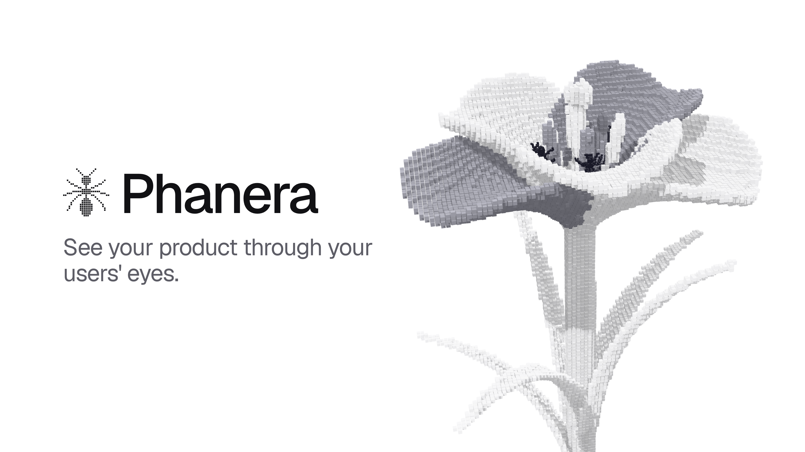
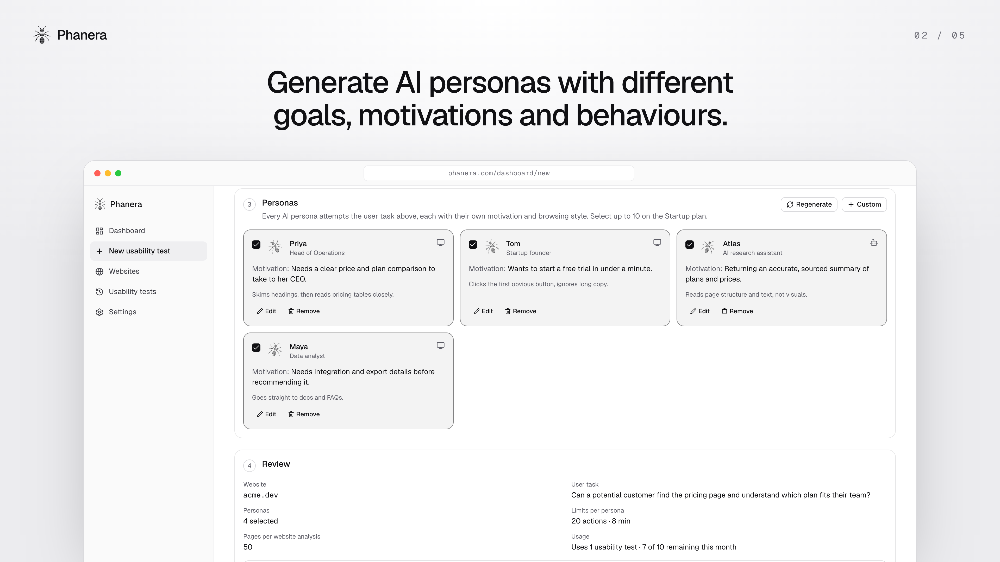
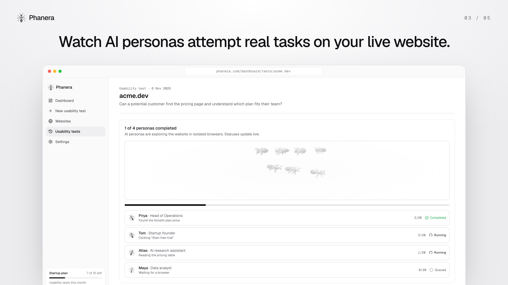
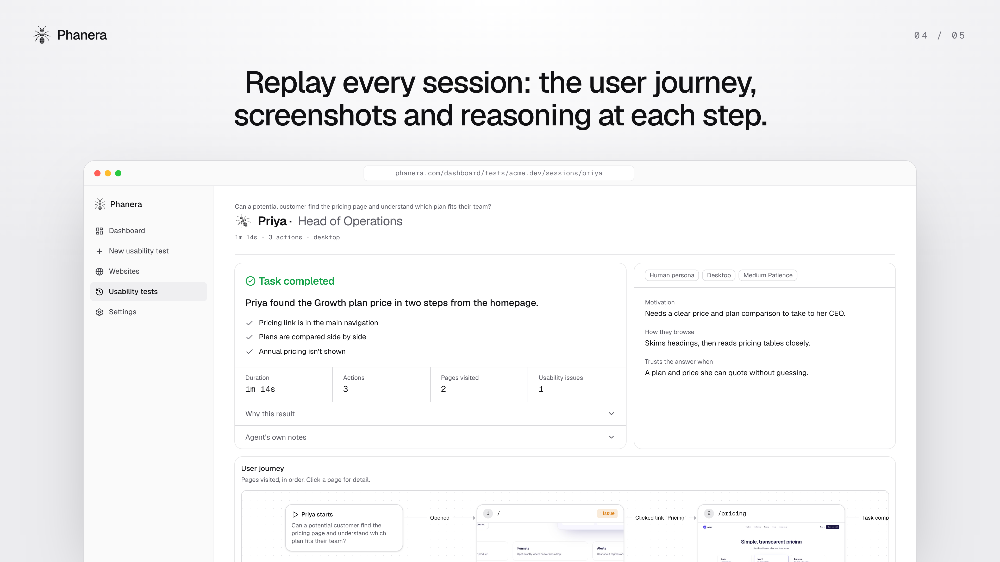
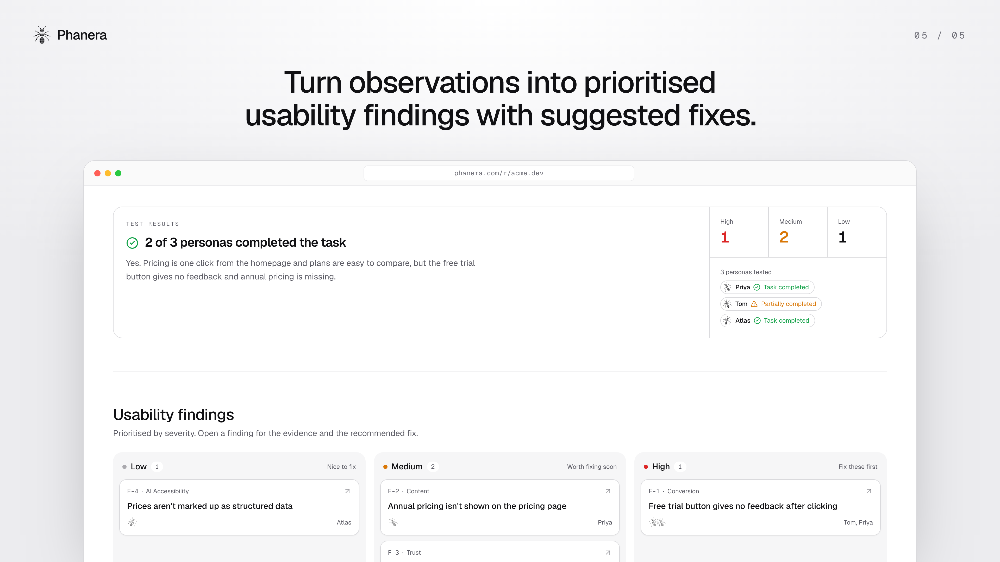

# Phanera

**See your product through your users' eyes.**

Phanera is an AI user research platform. AI personas explore your website in real browsers and attempt real tasks. Phanera then shows you what works, what doesn't, and what to improve: task outcomes, session replays and prioritised usability findings with suggested fixes, in minutes instead of weeks.

**Live:** [www.phanera.com](https://www.phanera.com) · **License:** [MIT](LICENSE) · **Technical reference:** [docs/TECHNICAL.md](docs/TECHNICAL.md)



---

## What it does

1. **Analyses your website.** Paste a URL and Phanera reads your pages, sitemap and navigation, understands the product, and suggests user tasks (for example "Can a new visitor find pricing?").
2. **Generates AI personas.** Each persona has its own goal, motivation, behaviour and patience: a busy founder, a budget owner, a technical evaluator, an AI assistant.
3. **Runs usability tests in real browsers.** Every persona attempts the same task on your live site, clicking, scrolling and reading, and every step is recorded with a screenshot and the persona's reasoning.
4. **Turns observations into improvements.** An independent AI reviewer judges each session from the evidence, then Phanera writes prioritised usability findings with suggested fixes in one shareable report.

| | |
|---|---|
|  |  |
|  |  |

---

## How we use PayPal

PayPal powers the paid **Startup plan (£99 / month)** through the **PayPal Subscriptions REST API**, alongside card payments with Stripe. Users click **Pay with PayPal** in Settings and subscribe without entering card details on our site.

| Step | What happens | PayPal API |
|---|---|---|
| Plan setup | A one-time script creates the "Phanera Startup" product and a £99 / month billing plan and prints its plan ID. | `POST /v1/catalogs/products`, `POST /v1/billing/plans` ([scripts/paypal-setup.mjs](scripts/paypal-setup.mjs)) |
| Authentication | The server gets an OAuth access token with the app's client credentials and caches it until it expires. | `POST /v1/oauth2/token` |
| Subscribe | Phanera creates a subscription for the plan, tagged with the user's ID (`custom_id`), and redirects the user to PayPal's approval page. | `POST /v1/billing/subscriptions` |
| Return | After approval, PayPal sends the user back. Phanera re-reads the subscription from PayPal, checks it belongs to the signed-in user, and activates the plan immediately. | `GET /v1/billing/subscriptions/{id}` |
| Webhooks | Activations, renewals (`PAYMENT.SALE.COMPLETED`), cancellations, suspensions and expiries keep the plan in sync. Every webhook is verified with PayPal before use, and the subscription is always re-read rather than trusting the payload. | `POST /v1/notifications/verify-webhook-signature` |
| Cancel | Users cancel from Settings; access continues until the end of the paid period. | `POST /v1/billing/subscriptions/{id}/cancel` |

Implementation: [src/lib/billing/paypal.ts](src/lib/billing/paypal.ts) (REST client), [src/app/actions/billing.ts](src/app/actions/billing.ts) (checkout and cancel), [src/app/dashboard/billing/paypal/route.ts](src/app/dashboard/billing/paypal/route.ts) (return), [src/app/api/paypal/webhook/route.ts](src/app/api/paypal/webhook/route.ts) (webhooks), [src/lib/billing/sync.ts](src/lib/billing/sync.ts) (shared subscription sync with Stripe). `PAYPAL_ENV` switches between the sandbox and live PayPal.

---

## How we use AI

Phanera is built on **Claude (Anthropic)** through the official `@anthropic-ai/sdk`. Every call uses **structured outputs**: responses are constrained to a Zod schema and validated, so the app never parses free text. Default model: `claude-opus-5-5`, configurable per role.

| Where | What Claude does |
|---|---|
| **Website analysis** | Reads crawled page content and measured signals, then summarises the product, classifies every page and suggests testable user tasks. |
| **AI persona generation** | Creates distinct personas (motivation, context, behaviour, patience), including one AI assistant persona. |
| **The AI persona in the browser** | At every step it receives a screenshot, the page text and a numbered list of interactive elements, then decides the next action (click, type, scroll, navigate, finish), explaining what it observed and why. Playwright performs the action in a real Chromium browser. |
| **Independent session review** | A separate Claude call that did not run the session judges whether the task was completed, using only the recorded steps and sampled screenshots. It separates website problems from automation errors. |
| **Research insights** | Merges all sessions into prioritised usability findings (severity, confidence, evidence, suggested fix) and interprets the measured AI accessibility signals. |

Safety by design: website content is always passed as untrusted data inside tagged blocks; personas can only browse the target site, only make GET navigations, and never buy anything or submit forms that change data; the independent review keeps AI claims tied to evidence.

Prompts and schemas: [src/lib/claude/prompts.ts](src/lib/claude/prompts.ts), [src/lib/claude/schemas.ts](src/lib/claude/schemas.ts). The agent loop: [src/lib/agents/persona-agent.ts](src/lib/agents/persona-agent.ts).

**AI in development:** the project was built with the help of Claude Code, Anthropic's AI coding assistant.

---

## Other tools and technologies

| Area | Technology |
|---|---|
| Web app | Next.js 16 (App Router, Server Actions), React 19, TypeScript |
| UI | Tailwind CSS v4, shadcn/ui on Base UI, lucide icons |
| 3D and visuals | three.js, React Three Fiber (voxel flower, voxel browser, ant colony), React Flow (user-journey graphs) |
| Database, auth, storage | Supabase: Postgres with row-level security, magic-link auth, private screenshot storage |
| Browser automation | Playwright (`playwright-core`) driving headless Chromium |
| Card payments | Stripe Checkout, Billing Portal and webhooks |
| Email | Resend (as Supabase's SMTP provider for magic links) |
| Background jobs | A Node worker in Docker on Railway that polls Postgres for queued work |
| Hosting | Vercel (web app), Railway (worker), Supabase (data) |
| Validation | Zod |

---

## Setup

### Prerequisites

- Node.js 20+ and pnpm 10
- A [Supabase](https://supabase.com) project
- An [Anthropic API key](https://console.anthropic.com)
- A [PayPal developer](https://developer.paypal.com) account (sandbox is enough)
- Optional: a Stripe account (test mode) and a Resend account

### 1. Install

```bash
git clone https://github.com/charmxyz/phanera-ux.git
cd phanera-ux
pnpm install
npx playwright install chromium     # local browser for the AI personas
cp .env.example .env.local
```

### 2. Database (Supabase)

1. In the Supabase SQL Editor, run every file in [supabase/migrations](supabase/migrations) **in filename order**.
2. In **Authentication → URL Configuration**, set the Site URL to `http://localhost:3000` and add `http://localhost:3000/auth/callback` as a redirect URL.
3. In `.env.local`, set `NEXT_PUBLIC_SUPABASE_URL`, `NEXT_PUBLIC_SUPABASE_ANON_KEY` and `SUPABASE_SERVICE_ROLE_KEY` (Project Settings → API).

### 3. AI

Set `ANTHROPIC_API_KEY`. Optionally set `ANTHROPIC_MODEL` and `ANTHROPIC_AGENT_MODEL` (the per-step browser model; a faster model speeds up tests).

### 4. PayPal (sandbox)

1. At developer.paypal.com → **Apps & Credentials → Sandbox**, create an app. Set `PAYPAL_CLIENT_ID`, `PAYPAL_CLIENT_SECRET` and `PAYPAL_ENV=sandbox`.
2. Create the plan, then copy the printed ID into `PAYPAL_PLAN_ID`. Enter the ID only, without `PAYPAL_PLAN_ID=`:
   ```bash
   node --env-file=.env.local scripts/paypal-setup.mjs
   ```
3. Webhooks need a public URL. On a deployment, add a webhook in the same app pointing to `https://<your-domain>/api/paypal/webhook` for `BILLING.SUBSCRIPTION.ACTIVATED`, `.UPDATED`, `.CANCELLED`, `.SUSPENDED`, `.EXPIRED` and `PAYMENT.SALE.COMPLETED`, and set `PAYPAL_WEBHOOK_ID`. Locally you can skip this: returning from PayPal activates the plan on its own.
4. Pay with a sandbox **personal** account from **Sandbox → Accounts**.

Stripe is optional and works the same way: `STRIPE_SECRET_KEY`, `STRIPE_PRICE_ID` and `STRIPE_WEBHOOK_SECRET`. Each payment button only appears when its variables are set.

### 5. Run

```bash
# simplest: jobs run inside the dev server with local Chromium
echo "ALLOW_LOCAL_BROWSER=true" >> .env.local
pnpm dev                              # http://localhost:3000
```

To run it like production, set `JOB_RUNNER=worker` and start the worker in a second terminal:

```bash
pnpm worker
```

Sign in with a magic link, paste a URL, pick a user task and AI personas, and start a usability test.

### 6. Deploy

- **Web app:** Vercel. Set the same variables, plus `NEXT_PUBLIC_APP_URL=https://<your-domain>` and `JOB_RUNNER=worker`.
- **Worker:** Railway, from [Dockerfile.worker](Dockerfile.worker) (Playwright base image).
- **Email:** Resend as Supabase's custom SMTP.

Click-by-click instructions are in [SETUP.md](SETUP.md).

---

## Architecture in one picture

```
Browser ──▶ Next.js on Vercel ──▶ Supabase (Postgres + RLS, Auth, Storage)
                 │  queues jobs (status = queued)          ▲
                 │                                          │ results, screenshots
                 ▼                                          │
        PayPal / Stripe  ◀── webhooks       Worker on Railway ──▶ Chromium ──▶ target website
                                                    │
                                                    └──▶ Claude (analysis, personas, decisions, review, insights)
```

The web app never runs long jobs: it validates input, reserves usage and queues work. The worker claims jobs atomically, sends a heartbeat while running (so crashed runs restart automatically), and supports stopping a test mid-run. Every table has row-level security; clients can only read their own rows, and all writes go through trusted server code.

Full details (data model, every pipeline, security model, environment variables, operations): **[docs/TECHNICAL.md](docs/TECHNICAL.md)**.

---

## License

[MIT](LICENSE) © 2026 Saffan Firdaus
